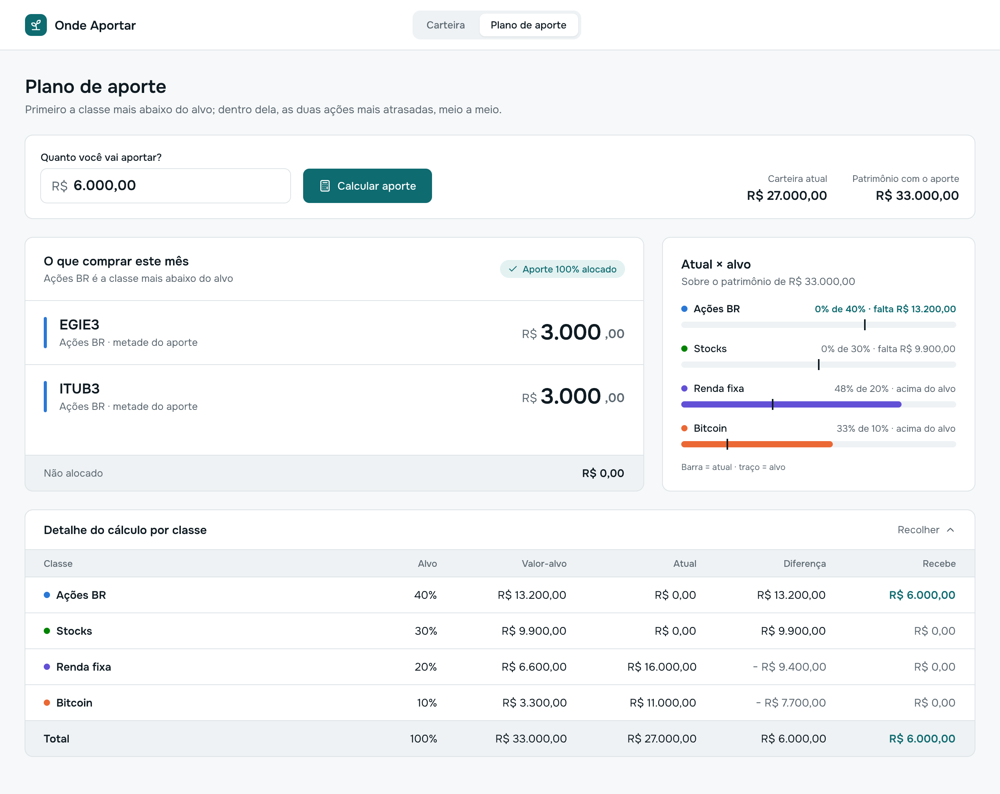
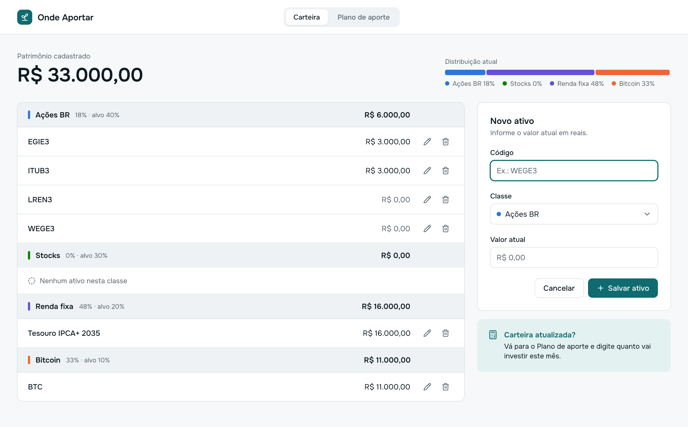

# contribution-planner

A personal app that works out where each monthly investment contribution should go, following the "Onde Aportar" ("where to invest") rule: the money goes to the asset class furthest below its target and, within that class, is split half and half between the two stocks furthest below their own targets, never pushing any of them past its target.

> **Status:** in design. The specs are approved and the screens are drawn; the application code has not been written yet.

The app is built for a Brazilian investor, so the UI and specs are written in Portuguese. Amounts are in Brazilian reais (R$).

## Screens

**Contribution plan** (*Plano de aporte*): enter how much you will invest and see what to buy.

**Portfolio** (*Carteira*): register your assets, grouped by class.

The design lives in [`design/contribution-planner.pen`](design/contribution-planner.pen) (made in Pencil). The images above are exported from it.

## How the calculation works

The portfolio has four classes with fixed targets: Brazilian stocks 40%, US stocks 30%, fixed income 20% and Bitcoin 10%.

1. Total wealth is the sum of all assets plus the contribution.
2. The contribution goes to the class with the largest gap to its target. Anything left over moves on to the next class.
3. Within the class, the amount is split half and half between the two stocks furthest below their own targets. No stock goes past its target; the excess goes to the other stock in the pair, then to the next ones.
4. The method never sells: anything at or above its target receives nothing.

Every rule, with verifiable examples, is in the specs (in Portuguese):

- [Contribution plan](.spec/features/contribution-plan/spec.md) and its [technical design](.spec/features/contribution-plan/design.md)
- [Weights and quarantine](.spec/features/asset-weights/spec.md) (next feature)

## Stack

| Layer | Technology |
|---|---|
| Backend | Java 25, Spring Boot 4, Maven, Flyway |
| Database | PostgreSQL 17 (Docker for local development) |
| Frontend | React, Vite, TypeScript, shadcn/ui, Onest font |
| Portfolio positions | Pluggy API through MeuPluggy (planned) |

Project constraint: zero cost for hosting and APIs. Money is always stored as integer cents (`long`), never as floating point.

## Disclaimer

A personal learning project. Not investment advice.
